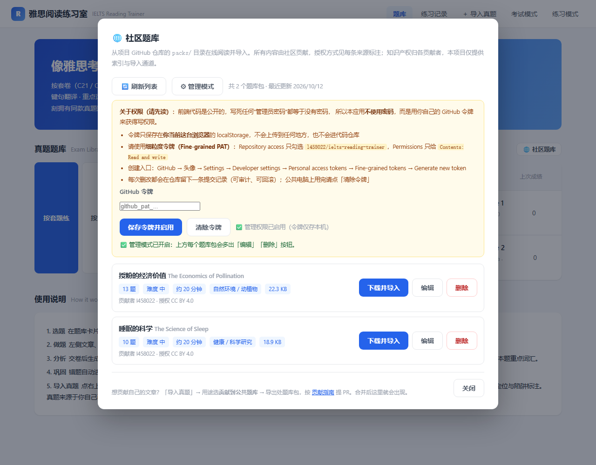

# 管理员手册 · 管理社区题库

> 适用对象：本仓库所有者 / 被授权维护 `packs/` 目录的人。
> 普通用户不需要读这份文档。

## 一、先说清楚权限模型（重要）

**本项目不使用"管理员密码"。** 原因很简单：这是一个纯前端应用，代码完全公开，
任何写死在代码里的口令都能被任何人看到 —— 那不是安全，只是心理安慰。

所以本项目的权限**来自 GitHub 本身**，有两条路：

| 方式 | 怎么做 | 适合 |
|------|--------|------|
| **A. GitHub 网页 / git**（推荐，零风险） | 直接在仓库里编辑或删除 `packs/` 下的文件，提交即可。CI 会自动重建索引 | 偶尔改一次、或改动较大 |
| **B. 应用内管理模式**（本手册重点） | 在应用里填入你自己的 GitHub 令牌，应用代你调用 GitHub API 提交改动 | 频繁增删改、想直接在应用里操作 |

两条路最终都是在仓库里产生**一次提交记录**，都可以审计、可以回滚。

## 二、应用内管理模式怎么用

### 第 1 步：创建一个"细粒度令牌"（Fine-grained token）

1. 打开 GitHub → 右上角头像 → **Settings**
2. 左侧最下 → **Developer settings**
3. **Personal access tokens** → **Fine-grained tokens** → **Generate new token**
4. 填写：
   - **Token name**：随便，例如 `ielts-reading-admin`
   - **Expiration**：建议 30 或 90 天（到期后重新生成，比永久令牌安全）
   - **Repository access**：选 **Only select repositories** → 只勾选 `l458022/ielts-reading-trainer`
   - **Permissions** → Repository permissions → 找到 **Contents** → 设为 **Read and write**
     （其余权限一律保持 No access）
5. 点 **Generate token**，复制生成的 `github_pat_...`（**只显示一次**）

> 为什么必须"细粒度 + 只授权这一个仓库"？这样即使令牌泄漏，攻击者也只能动这个仓库，
> 碰不到你的其他项目、账号设置或组织数据。

### 第 2 步：在应用里启用

1. 打开应用（[线上演示站](https://l458022.github.io/ielts-reading-trainer/) 或本地 `index.html`）
2. 首页 →「🌐 社区题库」→「⚙ 管理模式」
3. 粘贴令牌 → 「保存令牌并启用」
4. 列表里每个题库包会多出「**编辑**」「**删除**」按钮

### 第 3 步：可以做什么

| 操作 | 效果 |
|------|------|
| **删除** | 从 `packs/` 删除该 JSON 文件 → CI 自动重建索引 → 社区题库里消失（Git 历史仍可恢复） |
| **编辑** | 打开该包的完整 JSON 直接改（题干、选项、答案、keySentence、词汇表…）→ 保存提交 |
| **下载并导入** | 与普通用户相同：把包导入到本机题库练习 |

编辑保存前会自动校验两件事，不合格会拦下或提示：

1. **JSON 语法** —— 语法错直接拒绝
2. **结构** —— 必须有 `format: "ielts-reading-pack"` 且 `exams` 为非空数组
3. **keySentence 定位** —— 每道题的 `keySentence` 必须能在原文中**逐字找到**，
   否则报告页无法定位原句。有问题的题号会列出来，可以选择仍然保存

> 提交后 `raw.githubusercontent.com` 有 CDN 缓存（约 1–5 分钟）。
> 管理模式下应用改用 GitHub API 直读，所以你看到的是最新内容；其他用户稍后才会看到。

## 三、安全注意事项

- 令牌**只保存在你当前这台浏览器的 localStorage**，不会上传到任何地方，也不在代码仓库里
- **不要在公共电脑上保存令牌**；用完点「清除令牌」
- 令牌等同于对该仓库的写权限：**不要粘贴到聊天、Issue、截图里**
- 如果怀疑泄漏：立刻到 GitHub → Settings → Developer settings → 删除该令牌。
  已提交的内容可通过 Git 历史回滚，令牌一删立即失效
- 浏览器扩展、XSS 都可能读取 localStorage。本应用渲染的所有文本都经过转义
  （见 `esc()`），但如果你装了来源不明的浏览器扩展，风险仍存在 —— 建议用独立浏览器配置

## 四、已知局限（诚实说明）

- **只有单一管理员模型**：任何拿到令牌的人都拥有完整删改权，无法区分"谁能改哪些"、
  也无法做操作审批。真正的多人分权需要后端 + 账号体系（见 README 的"共享题库怎么工作"）
- **令牌存浏览器**：换电脑 / 换浏览器 / 清缓存后需要重新粘贴
- **无二次确认的服务端校验**：删除是直接生效的（应用内有 `confirm` 弹窗，
  且 Git 历史可恢复，但不是"先审后删"流程）

## 五、不用令牌的替代做法

如果只是偶尔维护，直接用 GitHub 网页更省事：

1. 打开 `packs/` 目录 → 点进要改的文件 → 右上角铅笔图标编辑 → 提交
2. 删除：文件页面 → 右上角 `...` → Delete file
3. 提交后 CI（`.github/workflows/manifest.yml`）会自动重建 `manifest.json`

---

相关文档：[贡献指南](CONTRIBUTING.md) · [安全政策](SECURITY.md) · [行为准则](CODE_OF_CONDUCT.md)
