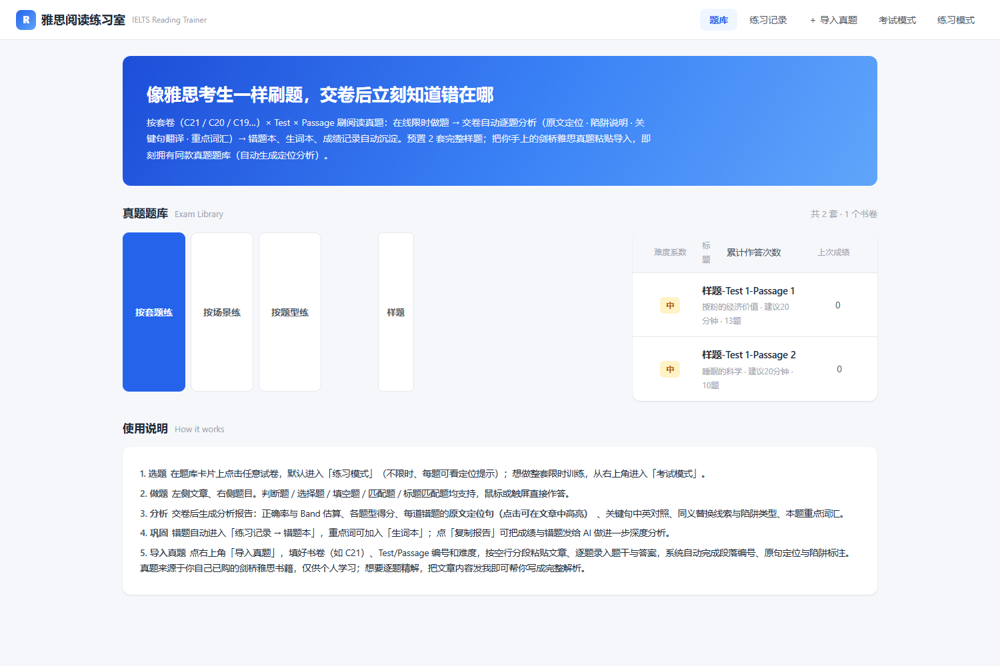
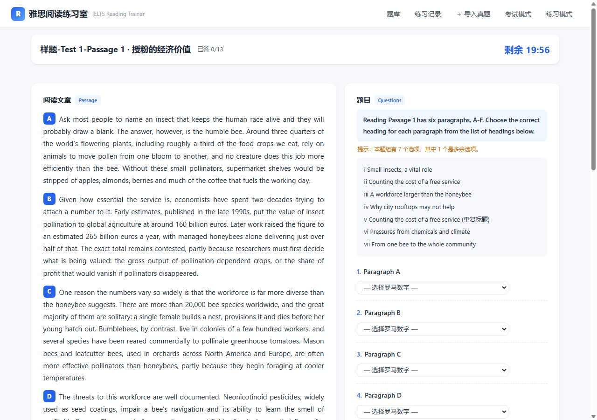
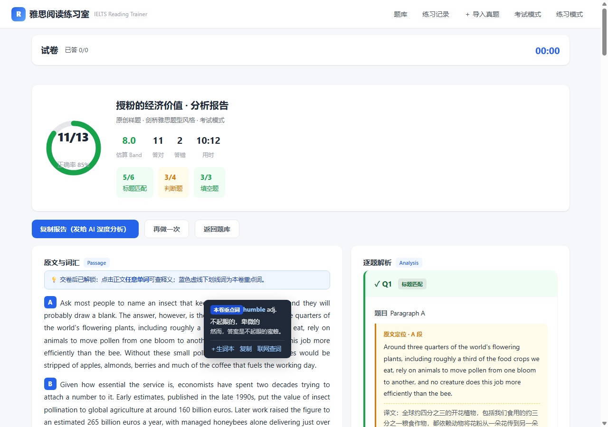
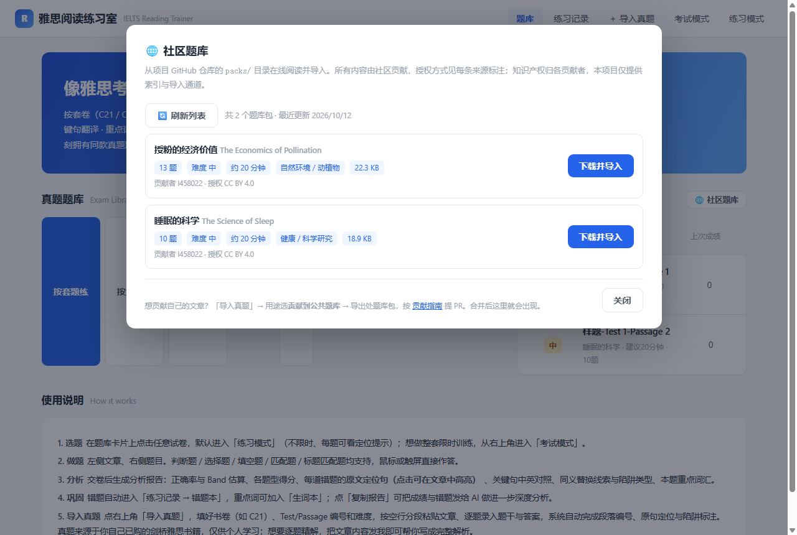

# 雅思阅读练习室 · IELTS Reading Trainer

> **中文** | [English](README_EN.md)
>
> 🚀 **[在线试用（免安装）](https://l458022.github.io/ielts-reading-trainer/)** ·
> 🤝 [参与贡献](CONTRIBUTING.md) · 🐛 [提交 Issue](https://github.com/l458022/ielts-reading-trainer/issues/new/choose) ·
> 📜 [行为准则](CODE_OF_CONDUCT.md) · 🔒 [安全政策](SECURITY.md)

一个纯前端、离线可用的雅思阅读练习平台：像雅思哥阅读板块一样刷真题风格的题目，交卷后**自动逐题分析**——定位原句、讲解错因、翻译关键句、列出重点词汇。

## 功能

| 模块 | 说明 |
|------|------|
| 题库（仿雅思哥） | **按套题练**（书卷 C21/C20… × Test × Passage 列表，含难度系数、累计作答次数、上次成绩、重新练习）、**按场景练**（话题分组）、**按题型练**（题型题量统计→筛选试卷） |
| 双模式 | **练习模式**（不限时、每题可看定位提示）/ **考试模式**（倒计时，到时自动交卷） |
| 六大题型 | 判断题(T/F/NG) · 单选题 · 填空题 · 人物/信息匹配 · 段落标题匹配 · 多选多 |
| 交卷分析 | 正确率 + Band 估算 + 各题型得分；逐题解析卡：**原句定位（点击在文章中高亮）**、关键句中英对照、同义替换线索、陷阱类型（绝对化/比较级反向/NG 话术）、本题重点词 |
| 点词查词 | **交卷后解锁**：报告页点击正文**任意单词**弹出释义（词性 + 中文 + 词形还原说明），可一键加入生词本/复制/联网查词（有道） |
| 词汇 | 报告页展示全文重点词表（含真题例句与中译）；文章内重点词以蓝色虚线下划线标注；生词本存入 localStorage |
| 沉淀 | 练习记录、错题本（自动收录，含原句与解析）、历史成绩 |
| 导入真题 | 粘贴文章（空行分段）+ 逐题录入题干答案 → **自动生成原句定位与陷阱标注** |
| 自动出题 | 粘贴任意英文文章 → 解析分段 → 规则引擎自动生成判断题/填空/标题匹配/单选，并自带校验（答案必须能被原文推出） |
| 贡献声明 | 导入时可声明「仅自己用」或「贡献到共享题库」；贡献需勾选版权/原创/隐私三项声明并留下署名与许可 |
| 题库包 | 一键导出/导入 `ielts-reading-pack` JSON 包，用于分享题库 |
| 社区题库 | 首页「🌐 社区题库」从项目 GitHub 仓库的 `packs/` 目录在线阅读题库包并一键导入（**不需要自建服务器**：raw 源 + jsDelivr CDN 双源兜底）；只有你主动点开时才联网，平时完全离线。**当前已收录 23 篇**（自然/环境/健康/科技/教育/能源/城市等雅思核心话题），全部来自 CC BY 4.0 开放授权信源并带署名，出处见 [packs/SOURCES.md](packs/SOURCES.md)。支持**一键导入全部**，本机题库从 2 套直接变 25 套 |
| 题库管理 | 仓库维护者在应用内填入自己的 GitHub 细粒度令牌，即可**直接删改共享题库**的文章与题目（每次操作都留下可审计、可回滚的提交记录）。**不使用"管理员密码"**——前端代码公开，写死口令等于没有口令，权限只能来自 GitHub 本身。详见 [ADMIN.md](ADMIN.md) |
| 深度分析 | 「复制报告」一键复制成绩+错题+定位句，可粘贴给任意 AI 做进一步分析 |

> 设计原则：答题过程中**不提供**查词与重点词提示，避免变相给提示；交卷后才开放查词与词汇学习功能。

## 界面

| 题库首页（套题/场景/题型） | 答题页（纯文本正文，无提示） |
|---|---|
|  |  |

| 交卷报告（逐题解析 + 原句定位） | 点词查词（交卷后解锁，任意单词可点） |
|---|---|
|  |  |

| 社区题库（GitHub 仓库即数据库，无需服务器） | 首页提示条（一键导入 23 篇开放授权文章） |
|---|---|
|  |  |

## 使用

直接用浏览器打开仓库根目录的 `index.html` 即可（无需服务器、无网络请求，数据存在本机浏览器）。

- 本地使用：双击 `index.html`，或拖进 Chrome / Edge
- 想用手机/局域网访问：`python -m http.server 8080` 后访问 `http://<电脑IP>:8080`

## 共享题库怎么工作的（无需服务器）

```
贡献者                          维护者/CI                        所有用户
导入文章 → 用途选「贡献」         审核声明 → 合并 PR               打开「🌐 社区题库」
→ 导出处题库包 → 提 PR    →    CI 自动扫 packs/ 生成 manifest  →  → 看到新包 → 一键导入
```

- 数据源就是本仓库的 `packs/` 目录，浏览器直接读取（GitHub 的 raw / jsDelivr 都开放 CORS），**因此不需要租服务器**
- `packs/manifest.json` 由 CI（`.github/workflows/manifest.yml`）在 `packs/` 变化时自动重建，无需手工维护
- 每个包都带 `contribution.contributor` 与 `contribution.license`，下游用户能看到每篇文章的授权来源
- 隐私与离线优先：应用默认零网络请求；只有打开「社区题库」或点「下载并导入」时才联网，学习记录始终只存本机

## 导入剑桥雅思真题（个人学习用途）

右上角「＋ 导入真题」→ 按空行分段粘贴文章 → 逐行录入题目（题干/题型/选项/答案）。
系统会自动：段落编号 A/B/C…、题干关键词回文定位、陷阱词检测、生成解析框架。
答案解析（keySentence/explain/keySentenceCn）可后续补充，也可把「复制报告」内容发给 AI 补写为 JSON。

> 说明：剑桥雅思真题全文属商业出版物，本仓库未内置真题原文，仅提供导入通道，请将自己的纸质书/已购内容用于个人学习。

## 目录

```
├── index.html            页面骨架（含导入弹窗：书卷/Test/Passage/难度/来源/贡献声明）
├── README.md             中文说明 / README_EN.md 英文说明
├── CONTRIBUTING.md       贡献指南·中 / CONTRIBUTING_EN.md 英
├── ADMIN.md              管理员手册（令牌申请、应用内删改共享题库、安全注意）
├── CODE_OF_CONDUCT.md    贡献者行为准则（Contributor Covenant 中文本）
├── SECURITY.md           安全政策（漏洞私下披露流程）
├── LICENSE               MIT（仅覆盖代码；贡献的文章按各自声明授权）
├── assets/
│   ├── style.css         样式（浅色学习界面，响应式）
│   ├── data-exam1.js     预置样题1：授粉的经济价值（13题）
│   ├── data-exam2.js     预置样题2：睡眠的科学（10题）
│   ├── engine.js         分析引擎：判分/切句/陷阱/同义替换/自动定位/Band估算
│   ├── generator.js      自动出题引擎：TFNG/填空/标题/单选生成 + 自校验
│   ├── dict-core.js      离线核心词典（约 1000 词，含词形还原，点词查词兜底）
│   └── app.js            交互：答题/倒计时/交卷/报告/点词查词/导入/贡献声明/错题本/生词本
├── packs/                公共题库包目录（社区贡献的 reading-pack-*.json）
│   ├── SOURCES.md        每篇文章的出处与署名（CC BY 合规）
│   └── manifest.json     CI 自动生成的题库索引（禁止手改）
├── scripts/
│   ├── build-manifest.js 扫描 packs/ 生成 manifest.json（CI 与本地均可跑）
│   ├── fetch-source.js   从开放授权信源抽正文（OWID / Europe PMC CC BY）
│   └── make-pack.js      出题 + 自校验 + 生成题库包
├── .github/
│   ├── workflows/        CI：单测 + E2E；以及 packs 变化时自动重建索引
│   ├── ISSUE_TEMPLATE/   Issue 表单：Bug / 功能建议 / 题库包贡献
│   └── PULL_REQUEST_TEMPLATE.md
└── test/
    ├── engine_test.js    引擎单元测试（node test/engine_test.js）
    ├── generator_test.js 自动出题测试（node test/generator_test.js）
    ├── dict_test.js      词典与覆盖率测试（node test/dict_test.js）
    ├── e2e-auto.html     浏览器端 E2E（自动答题→交卷→点词查词→导入→贡献声明）
    └── shot-*.png        页面渲染截图（含线上演示站实拍）
```

## 测试

```bash
node test/engine_test.js     # 28 项：数据完整性/判分/切句/陷阱/替换/定位/分析
node test/generator_test.js  # 47 项：四类题型生成/答案可推性/陷阱反向改写
node test/dict_test.js       # 18 项：词形还原/派生词优先/样题覆盖率(≥45%)
```

E2E（需本机 Chrome，把 `chrome` 换成本机 Chrome 可执行文件路径；Windows 默认在 `C:\Program Files\Google\Chrome\Application\chrome.exe`，macOS 在 `/Applications/Google Chrome.app/Contents/MacOS/Google Chrome`）：
```bash
chrome --headless --disable-gpu --no-sandbox \
  --virtual-time-budget=5000 --dump-dom "file:///<仓库绝对路径>/test/e2e-auto.html" | grep -o 'E2E \[[^<]*'
```
当前状态：单元测试 28 + 47 + 18 全通过；E2E 29/29 通过。
